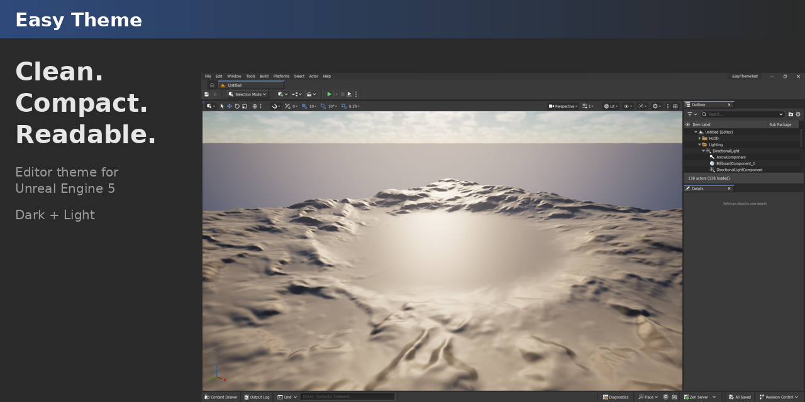
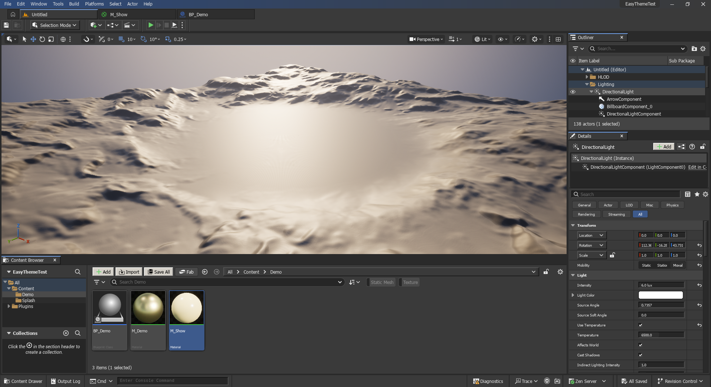
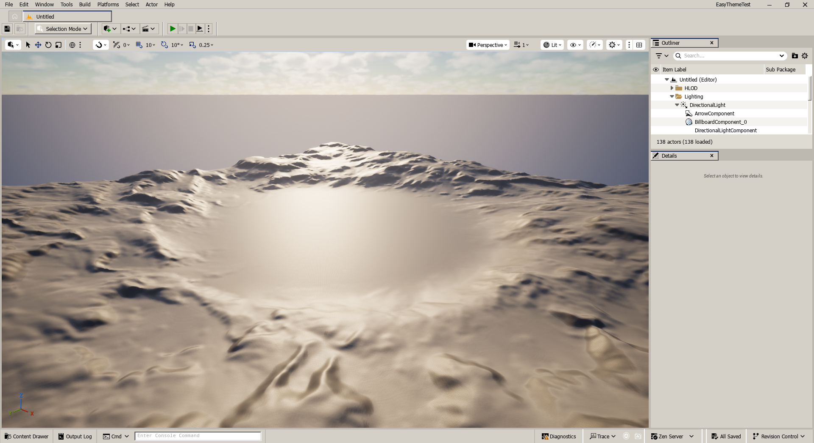
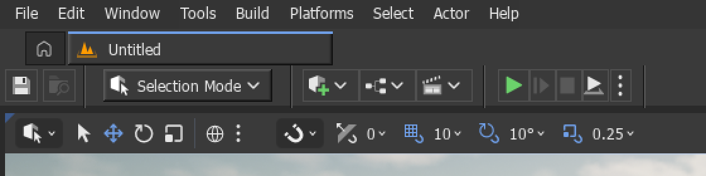
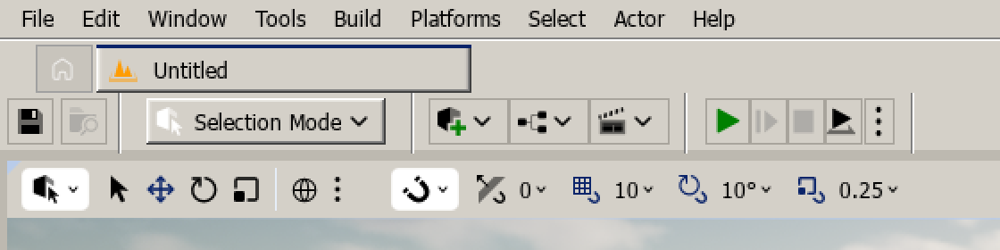
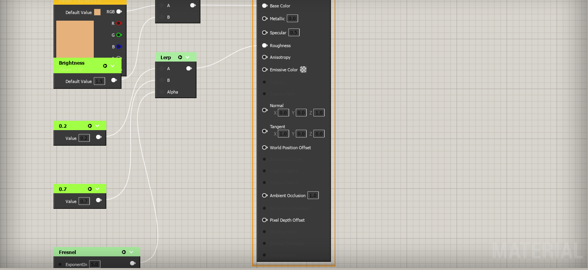
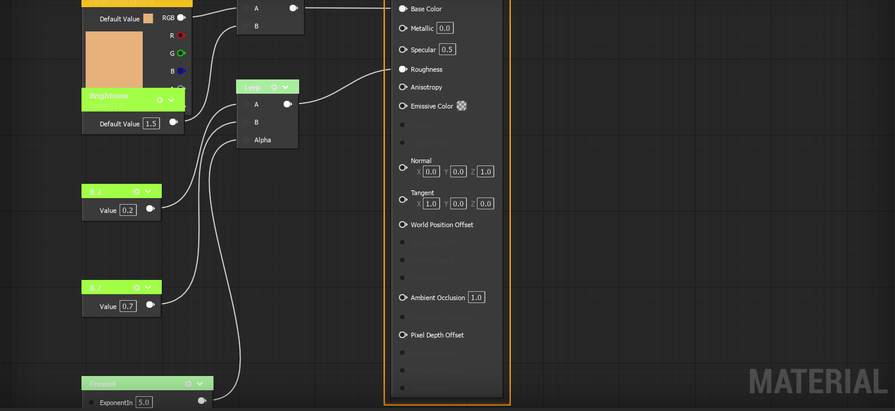
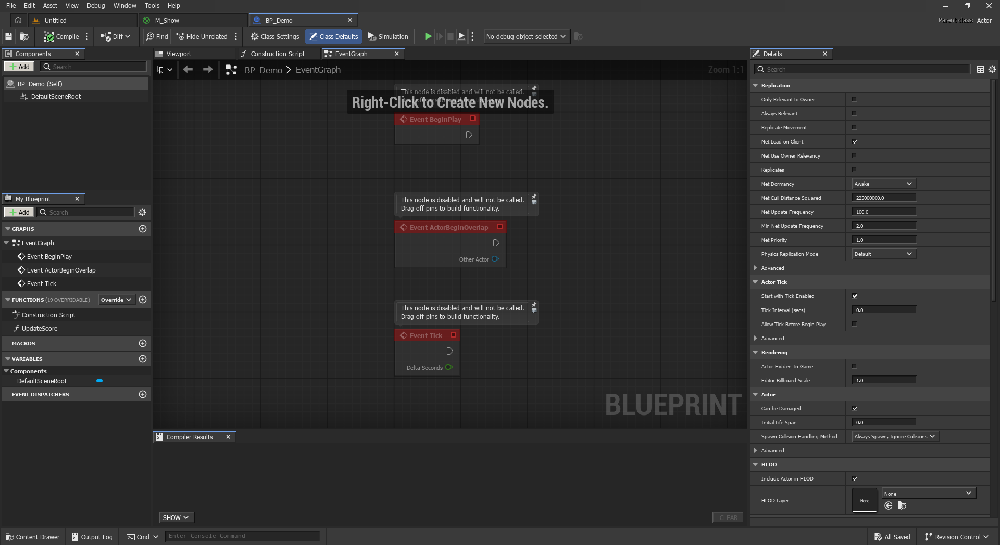

# Easy Theme for Unreal Engine 5

[Download](https://github.com/mapmodelers/ue5-theme-easy/releases/latest) · [Presentation page](https://mapmodelers.github.io/ue5-theme-easy/) · Free on Fab (coming) · MIT

**Clean, compact, high-clarity editor theme. Dark by default, Light included.**

Easy Theme restyles the whole Unreal Editor in a calm, classic desktop style: square controls, crisp 1-pixel frames and readable text in every panel. Switch between Dark and Light live from **Window > Easy Theme**.

## Features

- **Dark and Light.** Dark by default, Light one click away. The switch is live.
- **Compact.** Thinner tabs and toolbars, 16 px toolbar icons and tighter padding fit more content on screen.
- **Pixel-exact.** Bevelled buttons, sunken fields, square tabs, checkboxes and scrollbars, with no blurred edges.
- **Readable everywhere.** Fixes the editor's hard-coded colours (Place Actors, Content Browser, search fields and more) so no panel stays dark or turns unreadable.
- **Graphs follow the mode.** Square nodes; in Light, Blueprint and Material graphs sit on a light canvas (toggle: Light Graphs).
- **Slim title bar.** No oversized logo, so more room for your work.
- **Optional layout.** "Easy Theme - 3 Panes" in **Window > Load Layout**: viewport, Content Browser docked below, Outliner over Details.
- **Editor-only.** No engine changes and no effect on your game. To remove it, disable the plugin.

| Dark | Light |
|---|---|
|  |  |

| Light Graphs | Dark |
|---|---|
|  |  |

## Install

1. Download the `EasyTheme-…-UE5.8-Win64.zip` from [Releases](https://github.com/mapmodelers/ue5-theme-easy/releases/latest). It is prebuilt: no compiler needed.
2. Unzip it into your project's `Plugins` folder (`MyProject/Plugins/EasyTheme`), or into `Engine/Plugins/Marketplace` for every project.
3. Start the editor. The theme applies at startup.

From source: copy `Plugin/EasyTheme` instead (Visual Studio required, the editor compiles it on first launch).

## Use

| Where | What |
|---|---|
| Window > Easy Theme > Dark / Light | Switch the theme (live) |
| Window > Easy Theme > Light Graphs | Light canvas for graphs in Light mode (on by default) |
| Window > Easy Theme > Refresh UI | Rebuild every panel in the current theme |
| Window > Easy Theme > Use 3-Pane Layout | Optional compact layout (also in Window > Load Layout) |
| Window > Easy Theme > Report an Issue... | Pre-filled GitHub issue + local screenshot to attach (optional) |
| Window > Easy Theme > Remove Saved Settings | Delete the files Easy Theme saved |
| Console `EasyTheme.Dark 1` / `0` | Same switch from the console |

A few engine panels keep a private copy of their look until the next restart. After a switch, the plugin offers to restart.

## Uninstall

1. Optional: Window > Easy Theme > Remove Saved Settings deletes what it saved and restores your graph grid colours.
2. Disable Easy Theme in Edit > Plugins, or remove it from the Epic Games Launcher, then restart. The editor's own look comes back; nothing else changes.

## Compatibility

- Unreal Engine 5.8, Windows (Win64).
- The UI font is Tahoma, loaded from Windows. Easy Theme ships no font files.

## Keywords

Unreal Engine, UE5, editor theme, dark theme, light theme, compact UI, classic UI, Slate, editor plugin, readability, productivity

## Privacy and safety

- No telemetry, no data collection. The only network access is **Check for Updates**, and only when you click it: it asks GitHub for the latest release and, if you accept, downloads it, checks its SHA-256 and installs it when Unreal closes (your previous version is kept as a backup in `Saved/EasyTheme/Update`). "Report an Issue" only opens your browser; you choose what to attach.
- Editor-only: your game, your project content and the engine install are never modified.
- Files it writes, all in your Unreal user folders:
  - the Dark/Light and Light Graphs choices, in the editor settings (`[EasyTheme]`)
  - a backup of your graph grid colours while Light Graphs is on (your Editor Preferences keep your own values; they are restored on Dark, on exit and after a crash)
  - one layout file, "Easy Theme - 3 Panes", in the user layouts folder
- Window > Easy Theme > Remove Saved Settings deletes all of it and restores your grid colours.

## License

MIT. Free to use, modify and redistribute; see [LICENSE](LICENSE).

## Support

Issues and requests: [GitHub Issues](https://github.com/mapmodelers/ue5-theme-easy/issues)

---
Made by MapModelers. Unreal and Unreal Engine are trademarks of Epic Games, Inc. This plugin is not affiliated with or endorsed by Epic Games.
