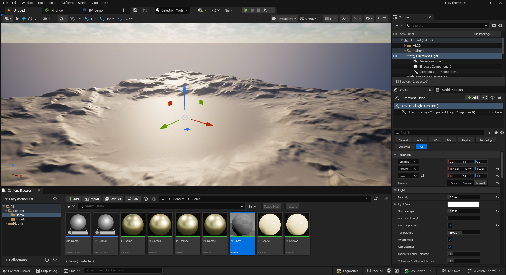
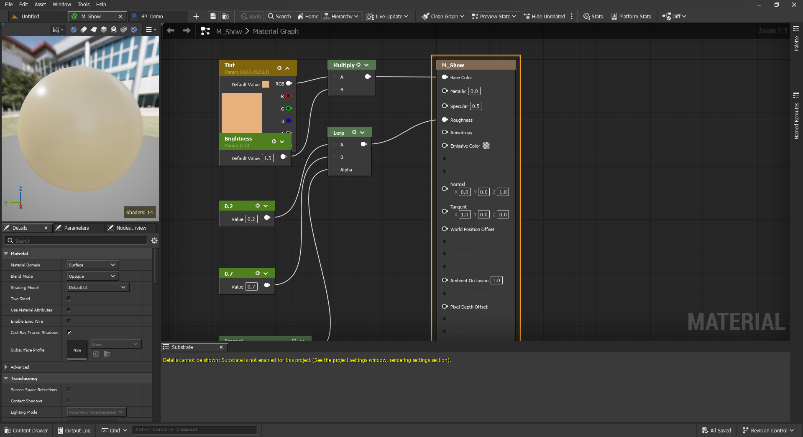

# Easy Theme for Unreal Engine 5

[Download](https://github.com/mapmodelers/ue5-theme-easy/releases/latest) · [Presentation page](https://mapmodelers.github.io/ue5-theme-easy/) · Free on Fab (coming) · MIT

**Compact, readable editor theme. Three looks: Dark, Light, Compact.**

## Features

- **Dark, Light, Compact.** Compact keeps Unreal's own colours with the compact layout.
- **More room.** Tabs and main toolbar on one row, thinner toolbars, square corners, slim title bar.
- **Readable everywhere.** Text and colour fixes in every panel, including plugin editors and floating windows.
- **Editor-only.** No engine changes, no effect on your game, no telemetry.

## Install

1. Download `EasyTheme-…-UE5.8-Win64.zip` from [Releases](https://github.com/mapmodelers/ue5-theme-easy/releases/latest) (prebuilt).
2. Unzip into `MyProject/Plugins/`, or `Engine/Plugins/Marketplace/` for every project.
3. Start the editor.

From source: copy `Plugin/EasyTheme` instead (Visual Studio required).

## Use

| Where | What |
|---|---|
| Window > Easy Theme > Dark / Light / Compact | Switch look (Compact applies at next start) |
| Window > Easy Theme > Light Graphs | Light graph canvas in Light |
| Window > Easy Theme > Use 3-Pane Layout | Viewport, Content Browser below, Outliner over Details |
| Window > Easy Theme > Show Home Tab | Hidden by default |
| Window > Easy Theme > Toolbar in Tab Bar | One row for tabs and toolbar, + for recent levels and assets |
| Window > Easy Theme > Check for Updates | Installs a newer release when Unreal closes |
| Window > Easy Theme > Report a Bug... | Pre-filled GitHub issue, screenshot and cleaned-up log to attach |
| Window > Easy Theme > Remove Saved Settings | Deletes everything Easy Theme saved |

Some panels pick up a new look only after a restart; Easy Theme offers it.

## Uninstall

Optional: Window > Easy Theme > Remove Saved Settings. Then disable Easy Theme in Edit > Plugins and restart.

## Privacy

No telemetry. The only network access is **Check for Updates**, when you click it (GitHub, SHA-256 checked, previous version kept as a backup). Settings are stored in your Unreal user folders; Remove Saved Settings deletes them. The Home tab setting is one line in your user `UserEngine.ini`.

## Compatibility

Unreal Engine 5.8, Windows (Win64). UI font: Tahoma, from Windows.

## License

MIT, see [LICENSE](LICENSE). Issues and requests: [GitHub Issues](https://github.com/mapmodelers/ue5-theme-easy/issues)

---
Made by MapModelers. Unreal and Unreal Engine are trademarks of Epic Games, Inc. Not affiliated with or endorsed by Epic Games.
